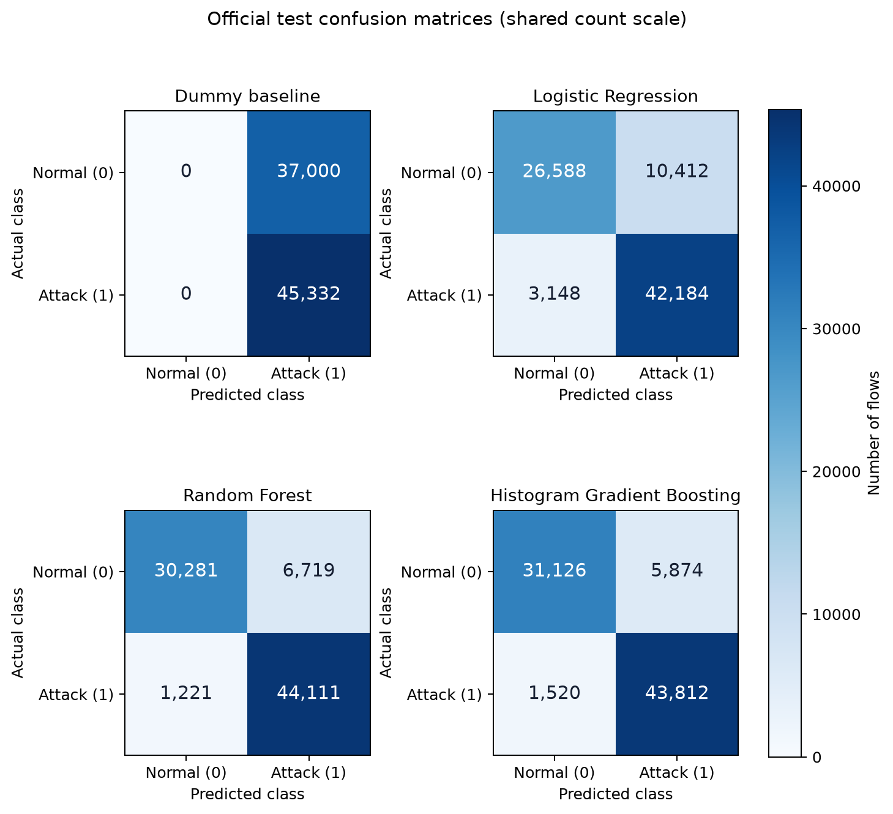

# Experiment 12 — Classification case study

**Title:** Comparison of Supervised Models for Network Flow Classification Using UNSW-NB15

**Status:** Editable draft based on the implemented and reproduced classification experiment. Confirm the student details, submission type, course code/cohort, citation format, and required screenshots before hand-in. This draft covers classification / CO4. The earlier planning request also names Experiment 13 regression, which remains pending.

## Aim

To compare Logistic Regression, Random Forest, and Histogram Gradient Boosting for classifying prepared network-flow records as normal or attack, and to explain their prediction errors using suitable classification metrics.

## Problem statement

Network traffic records can contain patterns associated with attacks. In this study, each row contains precomputed flow features and a binary label: normal (0) or attack (1). We investigate how a simple learned classifier and two tree ensembles perform on the published UNSW-NB15 training/test pair.

The inputs include flow duration and packet/byte statistics. This experiment classifies prepared records after the features have been collected. It does not evaluate early detection on an arriving flow or a deployed network protection system. The source dataset was created in a controlled cyber-range setting with normal activity and synthetic attack behaviours.

## Literature work — five journal studies

This working selection uses publisher records, available abstracts, and accessible full texts. It remains subject to the instructor's definition of recent/good-quality journals. The studies differ in inputs, task setup, and evaluation; their reported scores are not direct targets for our experiment.

| Study | Method and relevant idea | Connection and limitation |
|---|---|---|
| Maseno, Sun, and Wang (2026), *Journal of Computer Virology and Hacking Techniques* | Compares Logistic Regression, Random Forest, and XGBoost; studies reliability of SHAP explanations. | Close binary UNSW-NB15 model-comparison context. Our study uses the model-family comparison and training-only preprocessing principle; it does not implement SHAP auditing. |
| Kiflay et al. (2024), *Array* | Combines Random Forest predictions from flow and payload features using soft voting. | Uses UNSW-NB15 PCAP-derived features and payload bytes. Our inputs are the prepared CSVs, and we do not extract packet payloads or build its voting system. |
| Pospíchal et al. (2026), *Information* | Studies Random Forest with feature selection, threshold adjustments, and balancing for attack-versus-normal tasks. | Useful for understanding precision/recall trade-offs. It separates five attack-specific tasks; our target combines all attack categories into one class. |
| Mohiuddin et al. (2023), *Expert Systems with Applications* | Uses weighted XGBoost with hybrid metaheuristic feature selection/optimization. | Provides boosting and imbalance context on UNSW-NB15. The optimization method is outside our fixed-model comparison. |
| Telikani et al. (2024), *IEEE Transactions on Industrial Informatics* | Combines autoencoder/SVM methods with cost-sensitive and multitask learning. | Discusses rare/unknown attacks on UNSW-NB15 and BoT-IoT. Its architecture and task setup differ from our binary CSV study. |

The detailed source links and caveats are in [LITERATURE_REVIEW_MATRIX.md](LITERATURE_REVIEW_MATRIX.md). The advanced methods above are related work; our implementation uses standard scikit-learn classifiers and preprocessing.

## Objectives

1. Prepare and audit the flow features while excluding identifiers and fields that reveal the target.
2. Compare fixed Logistic Regression, Random Forest, and boosting configurations using the same data partitions and training-only preprocessing.
3. Interpret the models' errors using macro-F1, attack precision/recall, confusion matrices, and supporting metrics, including the effect of repeated predictor values.

## Data / input

Source: [official UNSW-NB15 dataset page](https://research.unsw.edu.au/projects/unsw-nb15-dataset). Input provenance and the creators' requested dataset citations are in [data/README.md](data/README.md).

- Training: 175,341 rows — 56,000 normal and 119,341 attack.
- Testing: 82,332 rows — 37,000 normal and 45,332 attack.
- Each CSV has 45 columns. The target is `label`; 42 predictors remain after excluding `label`, `attack_cat`, and `id`.
- `proto`, `service`, and `state` are categorical. The remaining 39 predictors are numeric.
- The audit found no empty fields, invalid numeric values, or infinite numeric values. No imputation or resampling is performed. The source service token `-` remains a category.

`attack_cat` is excluded because it describes the known family and maps directly to the binary answer. `id` is a prepared row identifier rather than a traffic measurement. The source files are unchanged and their hashes are verified before modelling. Full checks are in [the data audit](reports/unsw_nb15_data_audit.md).

## Methodology and algorithm

1. Verify input sizes/hashes, schema, labels, and numeric/categorical validity.
2. Create `X` from the 42 predictors and `y` from `label`.
3. Group identical parsed predictor vectors. Take the first fixed-seed split from `StratifiedGroupKFold(n_splits=5)` for an approximately 80/20 grouped holdout.
4. Fit one-hot category encoding inside each pipeline. Scale numeric fields for Logistic Regression; keep original numeric values for the tree models.
5. Fit and evaluate the predefined models on the fitting and validation partitions.
6. Refit the unchanged configurations on all official training rows. Evaluate all official test rows.
7. Also evaluate the subset of test rows whose predictor vectors were absent from full training.
8. Save metrics, matrices, figures, processing records, and dated run evidence.

The grouped holdout contains 140,274 fitting rows and 35,067 validation rows, with zero shared predictor groups. Only one fold is fitted for validation. This is not an averaged five-fold cross-validation study, and no hyperparameter or threshold search was performed.

### Classifiers and fixed settings

Logistic Regression models attack probability using a linear score:

$$p(y=1\mid x)=\frac{1}{1+e^{-(b+w^Tx)}}.$$

It provides a simple learned reference. We use C=1, `lbfgs`, 500 maximum iterations, balanced class weights, and seed 42. Scaling helps because numeric flow fields have different ranges.

Random Forest trains diverse trees using bootstrap samples and random feature subsets. Its class probabilities are averaged across the trees. We use 150 trees, maximum depth 20, a minimum of two samples per leaf, square-root feature selection, balanced bootstrap class weights, and seed 42. These choices constrain individual trees and keep the comparison manageable.

Boosting builds an additive model sequentially:

$$F_m(x)=F_{m-1}(x)+\eta h_m(x).$$

Each new tree is fitted to improve the current loss. Histogram-based boosting groups feature values into bins to make fitting efficient. We use learning rate 0.1, 100 iterations, at most 31 leaves, a minimum of 20 samples per leaf, L2 regularization 0.1, balanced class weights, and seed 42. Early stopping is explicitly disabled so the grouped holdout remains the validation boundary.

The configurations are chosen starting settings, not optimized values. Class weighting changes each class's total influence during fitting without creating or removing records. Random Forest and boosting are ensembles internally; the study does not combine the three classifiers using voting/stacking.

### Performance metrics

Treat attack as the positive class. TP is an attack detected correctly; FN is an attack missed; FP is a normal flow incorrectly flagged; TN is a normal flow identified correctly.

$$\text{Accuracy}=\frac{TP+TN}{TP+TN+FP+FN}$$
$$\text{Attack precision}=\frac{TP}{TP+FP},\qquad \text{Attack recall}=\frac{TP}{TP+FN}$$
$$F1=\frac{2PR}{P+R},\qquad \text{Macro-F1}=\frac{F1_{normal}+F1_{attack}}{2}$$

Balanced accuracy averages the recalls of the two classes. ROC-AUC evaluates the ordering of attack scores across thresholds. Macro-F1 gives both classes equal importance, while attack recall shows missed attacks. Precision and the confusion matrix show the false-alarm burden. The classifiers use their ordinary `predict()` rule; thresholds were not tuned.

## Implementation and tools

Python 3.12, pandas, NumPy, scikit-learn, and Matplotlib were used. Exact package versions are pinned in `requirements.txt` and recorded for each run. The libraries supply the classifier implementations; the project supplies the data checks, training pipelines, grouped holdout, evaluation, figures, and documentation.

- [Audit script](scripts/audit_unsw_nb15.py)
- [Model code](scripts/train_unsw_nb15_models.py): `prepare_features()`, `make_preprocessor()`, `model_pipelines()`, `run_analysis()`, and `measure()`.
- [Plotting code](scripts/plot_unsw_nb15_results.py)
- [Student walkthrough](STUDENT_WALKTHROUGH.md) and [run instructions](README.md).

Example of the training boundary:

```python
# The pipeline learns encoding/scaling from X_fit only.
estimator.fit(X_fit, y_fit)
validation_predictions = estimator.predict(X_validation)
```

The commented source contains the complete implementation. Dated run folders contain source snapshots, output hashes, warnings/timings, and success/failure notes. Add real code/output screenshots from your own run if the instructor requires screenshot pages. The figures below are actual generated outputs.

## Results and insights

Official-test results for the fixed configurations:

| Model | Accuracy | Macro-F1 | Attack precision | Attack recall | ROC-AUC |
|---|---:|---:|---:|---:|---:|
| Dummy baseline | 0.5506 | 0.3551 | 0.5506 | 1.0000 | 0.5000 |
| Logistic Regression | 0.8353 | 0.8292 | 0.8020 | 0.9306 | 0.9560 |
| Random Forest | 0.9036 | 0.9008 | 0.8678 | 0.9731 | 0.9848 |
| Histogram Gradient Boosting | 0.9102 | 0.9080 | 0.8818 | 0.9665 | 0.9855 |




Both tree ensembles have higher macro-F1 than Logistic Regression on this split. Boosting has the highest macro-F1 and accuracy, while Random Forest has higher attack recall. Random Forest misses 1,221 attacks and produces 6,719 false alarms; boosting misses 1,520 attacks and produces 5,874 false alarms. Random Forest therefore finds 299 additional attacks at the cost of 845 additional false alarms.

Boosting flags 15.88% of normal test flows, and Random Forest flags 18.16%. This shows why a high overall accuracy is insufficient for judging a network application. The Dummy baseline predicts every row as attack, giving perfect attack recall but no correctly identified normal flows.

The official test contains 8,541 rows with predictor vectors also present in training. The secondary result uses the other 73,791 rows; macro-F1 is 0.8200 for Logistic Regression, 0.8973 for Random Forest, and 0.9048 for boosting. This subset describes unfamiliar predictor combinations in the same test file. It does not establish recognition of unseen attack families or performance on another network.

All metrics from the revised implementation matched the preserved original run when checked. Detailed validation results, per-class metrics, matrices, and runtime records are in [the model comparison report](reports/unsw_nb15_model_results.md).

## Limitations

The prepared benchmark contains synthetic attack behaviour and repeated feature vectors. Grouping exact inputs prevents those vectors from crossing the fitting/validation boundary, but does not establish independence by capture day, host, or session. One holdout supplies no cross-validation spread or statistical significance claim. Parameters and thresholds were fixed, and the models were not evaluated on live traffic, early-flow inputs, or another dataset.

The literature studies use different features and tasks; their published scores should not be compared directly with our values. The five-paper selection and final citation format still need to meet the instructor's requirements.

## Conclusion

On the prepared UNSW-NB15 split, both tree ensembles improved macro-F1 over the simple Logistic Regression reference. Boosting produced the best balance of class F1 scores, while Random Forest detected more attacks with more false alarms. The experiment demonstrates supervised classification and two ensemble families using standard library tools, with documented preprocessing and evaluation boundaries.

## Future scope

Possible extensions are repeated grouped validation to examine stability, a small training/validation-only parameter comparison, and decision thresholds chosen from validation according to the relative cost of missed attacks and false alarms. A separate capture or dataset would be needed to investigate transfer beyond this benchmark. Any new experiment should have a declared evaluation protocol and dated evidence.

## References for the literature review

1. Maseno, E. M., Sun, Y., and Wang, Z. (2026). Reliability auditing of explanations for machine-learning-based intrusion detection systems. *Journal of Computer Virology and Hacking Techniques*, 22, article 80. [DOI](https://doi.org/10.1007/s11416-026-00664-7)
2. Kiflay, A., Tsokanos, A., Fazlali, M., and Kirner, R. (2024). Network intrusion detection leveraging multimodal features. *Array*, 22, 100349. [DOI](https://doi.org/10.1016/j.array.2024.100349)
3. Pospíchal, J., Augustín, A., Huraj, L., Střelec, P., and Gabriška, D. (2026). Random Forest-Based Network Intrusion Detection with Feature Selection and Class Balancing on UNSW-NB15 Traffic. *Information*, 17(9), 836. [DOI](https://doi.org/10.3390/info17090836)
4. Mohiuddin, G., et al. (2023). Intrusion Detection using hybridized Meta-heuristic techniques with Weighted XGBoost Classifier. *Expert Systems with Applications*, 232, 120596. [DOI](https://doi.org/10.1016/j.eswa.2023.120596)
5. Telikani, A., et al. (2024; online 2023). A Cost-Sensitive Machine Learning Model With Multitask Learning for Intrusion Detection in IoT. *IEEE Transactions on Industrial Informatics*, 20(3), 3880–3890. [DOI](https://doi.org/10.1109/TII.2023.3314208)

Dataset attribution is separate: include the creators' requested works from [data/README.md](data/README.md) in the final bibliography and apply the instructor's citation style consistently.
