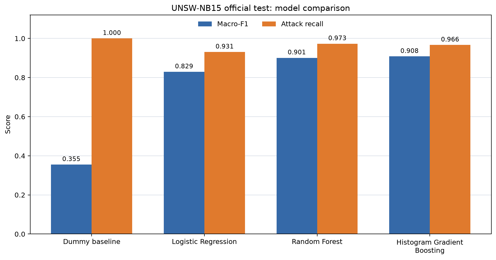

# SML case study: UNSW-NB15 classification

This project compares Logistic Regression, Random Forest, and Histogram Gradient Boosting for normal-versus-attack classification. A Dummy baseline helps interpret the scores. It uses the official prepared UNSW-NB15 training and testing CSVs and precomputed flow features.

Start with [STUDENT_WALKTHROUGH.md](STUDENT_WALKTHROUGH.md) for the explanation. The model comparison is a fixed-parameter benchmark with one grouped validation holdout. Random Forest and boosting are ensembles internally; the project does not combine the three classifiers using voting or stacking.

The revised workflow reproduced every score from the preserved original run. On the official test split, Histogram Gradient Boosting achieved macro-F1 0.9080 and accuracy 91.02%; Random Forest achieved attack recall 97.31%. Boosting also flagged 15.88% of normal test flows, so accuracy alone does not describe its suitability for a network application.



[Detailed results](reports/unsw_nb15_model_results.md) · [Editable Experiment 12 report draft](EXPERIMENT_12_REPORT_DRAFT.md) · [Literature review](LITERATURE_REVIEW_MATRIX.md) · [Action log](ACTION_LOG.md)

## Run the project on Windows

Use Python 3.12 and PowerShell. Run the following from this project folder. Install the pinned packages once in an isolated environment:

```powershell
python -m venv .venv
& .\.venv\Scripts\python.exe -m pip install -r requirements.txt
```

Run the audit first, then the model comparison:

```powershell
& .\scripts\run_audit.ps1
& .\scripts\run_models.ps1
```

Activation is unnecessary: the runners use `.venv/Scripts/python.exe` when it exists. To use another already configured environment, pass its interpreter explicitly:

```powershell
& .\scripts\run_models.ps1 -Python 'C:\path\to\environment\Scripts\python.exe'
```

Both tasks use the same environment selection. The runners never install packages themselves. If a dependency is missing, the failed attempt is recorded. The environment used by each run is listed in its JSON and log. Exact elapsed time depends on the machine.

## Inputs

Place these unchanged files in `data/raw/`:

- `UNSW_NB15_training-set.csv`: 175,341 records, 32,293,018 bytes.
- `UNSW_NB15_testing-set.csv`: 82,332 records, 15,380,800 bytes.

Both have 45 columns. The 42 predictors exclude `label`, `attack_cat`, and `id`. Three predictors (`proto`, `service`, `state`) are categorical; the other 39 are numeric. File hashes are checked against the staged acquisition record. The audit found no missing or invalid numeric values. The model run stops for inspection if missing/invalid/infinite numeric or empty categorical values appear. It performs no imputation or resampling.

Dataset source: [UNSW-NB15 official research page](https://research.unsw.edu.au/projects/unsw-nb15-dataset). Use the dataset creators' requested citations when preparing the final report. The five recent journal papers in the literature matrix are a separate course requirement.

## Outputs and logs

- `reports/unsw_nb15_data_audit.md`: data dimensions, values, classes, duplicates, and leakage checks.
- `reports/unsw_nb15_model_results.md`: methods, model settings, metrics, confusion matrices, error trade-offs, and limitations.
- JSON companions: input hashes, software versions, processing steps, effective classifier parameters, warnings, and timings.
- `reports/unsw_nb15_model_metrics.csv`: the scores in a reusable form.
- PNG figures: comparison bars and readable 2-by-2 confusion matrices.
- `reports/runs/<date-time-task>/`: a permanent copy of that run's outputs, source scripts, requirements, manifest, and execution notes. Failed runs also retain a record here.
- `ACTION_LOG.md`: decisions and dated success/failure summaries.

Latest report copies are updated after all calculations and charts succeed. Older dated results are preserved. Do not treat two test subsets as two independent datasets: the secondary result excludes predictor vectors seen in training from the same official test file.

The normal Python entry point also produces the report and charts:

```powershell
& .\.venv\Scripts\python.exe .\scripts\train_unsw_nb15_models.py
```

Use the PowerShell runners for the automatic dated archive and action-log record. The `--emit-bundle` option is an output-transfer helper for restricted environments; it is not a machine-learning method. For a report-only chart refresh, `plot_unsw_nb15_results.py --results <result-json>` uses saved metrics and performs no model fitting.

## Course scope and remaining submission work

This classification work fits lab Experiment 12 / CO4. The supplied planning chat states that Experiments 12 and 13 must be case-study reports; Experiment 13 regression remains pending. The lab manual identifies `0701260405`; the signed theory plan identifies `0701260304`. These appear to be different theory/lab course codes. Confirm the cover and theory-CA3 submission format. Theory CA3 is mapped to CO3 regression and CO4 classification/ensembles; the current classification study does not supply regression evidence.

The final assignment still needs confirmed cover details, the instructor's paper-recency/quality requirements, code/output screenshots, and the complete course-template report. `LITERATURE_REVIEW_MATRIX.md` distinguishes the five studies' different tasks and methods. They are related work, and their advanced methods are not part of this implementation.

The dataset was built in a cyber-range setting and includes synthetic attack activity. These scores describe prepared flow classification on that benchmark. Capture-day/session independence, unseen attack types, early-flow detection, and live-network performance have not been established.

## Repository layout

```text
scripts/            Commented audit, model, plotting, and run scripts
data/raw/           Unchanged prepared CSV inputs
data/README.md      Input provenance and dataset attribution
reports/            Latest audit, metrics, reports, and figures
reports/runs/       Dated source/output snapshots and success/failure evidence
course_materials/   User-supplied course references and templates
notes/              Historical planning chat and research context
```

The course references and historical notes are preserved for traceability. Use this README, the latest reports, and the action-log overview for current status. The repository was private at upload. Dataset and course materials retain their original authorship and terms; no general redistribution license is assigned to them.
