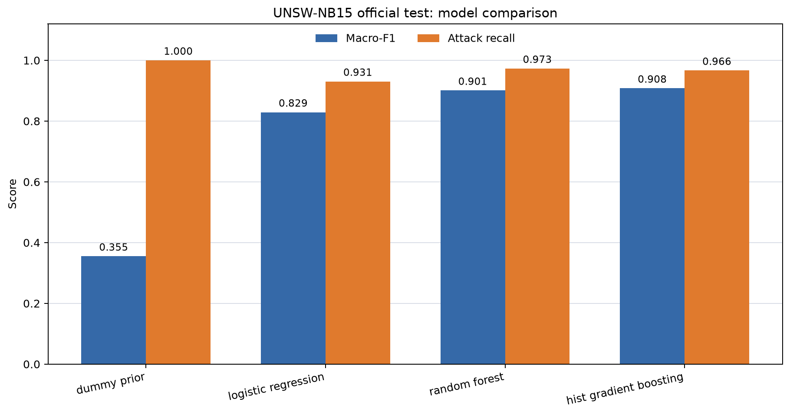
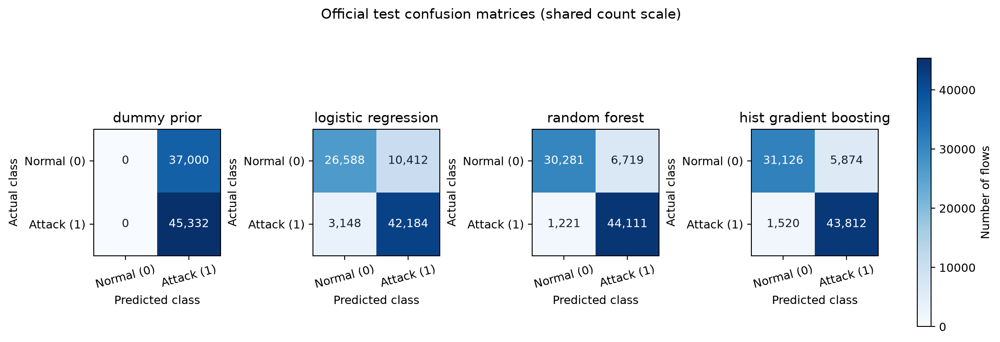

# UNSW-NB15 Binary Classification: Model Comparison

Run time: 2026-10-14T01:39:57+05:30 (3.12.10, pandas 3.0.6, scikit-learn 1.9.1, Matplotlib 3.11.2).

This is a benchmark comparison using the official prepared train/test files. It does not establish production IDS performance.

## Method and leakage controls

- Target: `label` (1 = attack, 0 = normal). `id` and `attack_cat` are excluded from predictors.
- `attack_cat` was excluded because the audit showed a deterministic mapping from each category to the binary target.
- Predictors are the 42 remaining flow fields. `proto`, `service`, and `state` are one-hot encoded; `service = '-'` stays a category.
- Numeric fields are parsed without changing the raw CSV; unexpected invalid numeric values stop the run. Pipelines include median imputation, with StandardScaler for Logistic Regression.
- `proto`, `service`, and `state` use a `__MISSING__` fill followed by one-hot encoding; unseen categories are ignored at scoring time. The source token `service = '-'` remains a regular category. These transformers fit only on each training partition; no resampling is used.
- Validation groups are hashed from predictor values, so identical vectors stay on one side of the fit/validation boundary.
- Model settings were fixed before evaluating the official test file. Every model is first checked on the grouped validation fold, then fit on the full official training split and evaluated on the official test split.
- The secondary `test_unseen_predictor_vectors` score is limited to official-test rows whose 42 predictors were absent from all official training rows.

## Model families

| Model | Role | Fixed settings |
|---|---|---|
| dummy_prior | prior-only reference | strategy=training class prior |
| logistic_regression | linear reference classifier | C=1.0, solver=lbfgs, max_iter=500, class_weight=balanced |
| random_forest | bagging ensemble | n_estimators=150, max_depth=20, min_samples_leaf=2, max_features=sqrt, class_weight=balanced_subsample |
| hist_gradient_boosting | boosting ensemble | learning_rate=0.1, max_iter=100, max_leaf_nodes=31, min_samples_leaf=20, l2_regularization=0.1, class_weight=balanced |

## Grouped validation results

| Model | Rows | Accuracy | Balanced accuracy | Macro-F1 | Attack precision | Attack recall | Attack F1 | ROC-AUC |
|---|---:|---:|---:|---:|---:|---:|---:|---:|
| dummy_prior | 35,067 | 0.6806 | 0.5000 | 0.4050 | 0.6806 | 1.0000 | 0.8100 | 0.5000 |
| logistic_regression | 35,067 | 0.9328 | 0.9210 | 0.9225 | 0.9479 | 0.9538 | 0.9508 | 0.9847 |
| random_forest | 35,067 | 0.9505 | 0.9489 | 0.9437 | 0.9735 | 0.9532 | 0.9632 | 0.9929 |
| hist_gradient_boosting | 35,067 | 0.9494 | 0.9510 | 0.9428 | 0.9785 | 0.9464 | 0.9622 | 0.9930 |

## Official test results

| Model | Rows | Accuracy | Balanced accuracy | Macro-F1 | Attack precision | Attack recall | Attack F1 | ROC-AUC |
|---|---:|---:|---:|---:|---:|---:|---:|---:|
| dummy_prior | 82,332 | 0.5506 | 0.5000 | 0.3551 | 0.5506 | 1.0000 | 0.7102 | 0.5000 |
| logistic_regression | 82,332 | 0.8353 | 0.8246 | 0.8292 | 0.8020 | 0.9306 | 0.8615 | 0.9560 |
| random_forest | 82,332 | 0.9036 | 0.8957 | 0.9008 | 0.8678 | 0.9731 | 0.9174 | 0.9848 |
| hist_gradient_boosting | 82,332 | 0.9102 | 0.9039 | 0.9080 | 0.8818 | 0.9665 | 0.9222 | 0.9855 |

## Secondary test results on unseen predictor vectors

| Model | Rows | Accuracy | Balanced accuracy | Macro-F1 | Attack precision | Attack recall | Attack F1 | ROC-AUC |
|---|---:|---:|---:|---:|---:|---:|---:|---:|
| dummy_prior | 73,791 | 0.5185 | 0.5000 | 0.3415 | 0.5185 | 1.0000 | 0.6829 | 0.5000 |
| logistic_regression | 73,791 | 0.8230 | 0.8194 | 0.8200 | 0.7797 | 0.9180 | 0.8432 | 0.9494 |
| random_forest | 73,791 | 0.8985 | 0.8958 | 0.8973 | 0.8550 | 0.9685 | 0.9082 | 0.9823 |
| hist_gradient_boosting | 73,791 | 0.9056 | 0.9035 | 0.9048 | 0.8706 | 0.9607 | 0.9134 | 0.9831 |

## Confusion matrices

Rows are actual labels [0, 1]; columns are predicted labels [0, 1].

### dummy_prior

| | Predicted normal (0) | Predicted attack (1) |
|---|---:|---:|
| Actual normal (0) | 0 | 37,000 |
| Actual attack (1) | 0 | 45,332 |

### logistic_regression

| | Predicted normal (0) | Predicted attack (1) |
|---|---:|---:|
| Actual normal (0) | 26,588 | 10,412 |
| Actual attack (1) | 3,148 | 42,184 |

### random_forest

| | Predicted normal (0) | Predicted attack (1) |
|---|---:|---:|
| Actual normal (0) | 30,281 | 6,719 |
| Actual attack (1) | 1,221 | 44,111 |

### hist_gradient_boosting

| | Predicted normal (0) | Predicted attack (1) |
|---|---:|---:|
| Actual normal (0) | 31,126 | 5,874 |
| Actual attack (1) | 1,520 | 43,812 |

## Reading the results

Use macro-F1 to summarize both classes evenly and attack recall to show how many attack flows were found. Accuracy alone can hide a weak result for one class. The training and test attack proportions differ, so compare per-class results and avoid attributing a metric gap to the model alone.

The official test split contains repeated predictor vectors, including a small number whose label differs from the label attached to that same vector in training. The secondary unseen-vector result helps show how scores change when test vectors have not appeared in training; neither score represents live-network deployment.

## Reproducibility record

- Random seed: 42; validation method: first fold from StratifiedGroupKFold(n_splits=5, shuffle=True, random_state=42), groups=hash of parsed 42 predictor values.
- Fit rows: 140,274; validation rows: 35,067; predictor groups shared across fit/validation: 0.
- Official-test rows: 82,332; rows with a predictor vector previously seen in training: 8,541; unseen rows: 73,791.
- The JSON companion records input hashes, processing steps, software versions, group split counts, model settings, fit times, and all reported metrics.

## Processing log

- 1. Re-verified staged training/testing file sizes, SHA-256 digests, and row counts before modeling.
- 2. Read source CSVs as strings with NA coercion disabled; did not alter or rewrite raw files.
- 3. Constructed y from label and X from the 42 flow predictors only; removed id and attack_cat before preprocessing.
- 4. Parsed the 39 numeric predictors with numeric coercion and an explicit invalid-value check; retained proto, service, and state as categories, including service '-'.
- 5. Hashed parsed X vectors only to create feature groups; group hashes were never input to any estimator.
- 6. Selected the first fixed-seed StratifiedGroupKFold split; verified zero feature groups crossed fit/validation.
- 7. Inside each pipeline, configured median imputation for numeric fields, StandardScaler for Logistic Regression, and a constant __MISSING__ fill plus one-hot encoding with unknown-category ignore for categorical fields; fit Dummy prior, balanced Logistic Regression, class-balanced Random Forest, and class-balanced histogram gradient boosting on the fit partition, with no resampling.
- 8. Recorded validation metrics, then refit each unchanged model configuration on all official training rows and evaluated the official test rows.
- 9. Calculated a secondary metric set only on test rows whose predictor vectors were absent from the full training split.
- 10. Generated result JSON, Markdown, Matplotlib PNG charts, and a tidy CSV using derived outputs only.
